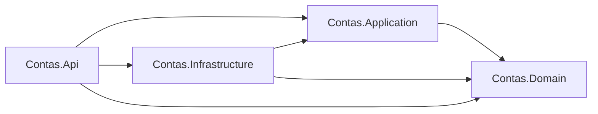
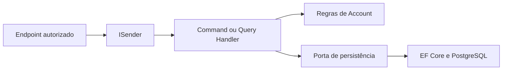

# Arquitetura

[Início](../README.md) · [Dependências](dependencias.md) · [Mensageria](mensageria.md)

O backend é um monólito modular com um host ASP.NET Core. Clean Architecture organiza as dependências entre camadas. Vertical slices agrupam cada comando ou consulta com seu handler. O domínio concentra as regras de contas.

## Contextos e camadas

| Contexto | Responsabilidade | Implementação atual |
|---|---|---|
| Contas / Onboarding | Cadastro, ciclo de vida, carteiras e titulares | Agregado `Account` e casos de uso próprios |
| Fraude | Consultar status e simular análise de eventos | Rota protegida na API e consumidor externo demonstrativo |
| Cartões | Consultar elegibilidade e simular processamento | Query própria, rota protegida e consumidor externo demonstrativo |
| Identidade | Autenticar usuários e clientes de serviço | Keycloak |

As fronteiras de negócio aparecem nas pastas e nos contratos. Os projetos .NET são separados por camada. Fraude e Cartões têm comportamento demonstrativo e usam os dados de Contas para as consultas síncronas.

As setas abaixo representam referências entre projetos.

| Camada | Conteúdo | Por que existe |
|---|---|---|
| Domain | `Account`, value objects, eventos e `Result` | Mantém regras válidas em qualquer entrada da aplicação |
| Application | Commands, queries, handlers e portas | Organiza cada caso de uso e permite trocar adaptadores |
| Infrastructure | EF Core, PostgreSQL, Redis, auditoria e outbox | Implementa persistência e comunicação externa |
| Api | Minimal APIs, autorização, contratos e composição | Traduz HTTP para casos de uso e resultados |
| Web | Páginas Next.js e proxy de servidor `/backend` | Entrega a interface e encaminha chamadas autenticadas |

## Domínio rico e CQRS

O agregado `Account` abre, edita, exclui e altera vínculos. `Cpf`, `AccountHolderName`, `AccountId`, `AccountVersion` e `AccountSubject` dão significado aos valores. As regras retornam `Result<T>` com códigos de erro. Exceções de bibliotecas são tratadas nas fronteiras de I/O e no pipeline HTTP.

Commands e queries compartilham o banco. O Mediator registra handlers por geração de código. Handlers e `DbContext` usam escopo da requisição. O worker cria um escopo por lote. A publicação externa é feita pelo worker da outbox. [Mediator](https://github.com/martinothamar/Mediator)

## Escrita consistente

Na abertura, edição e exclusão, `AccountStore` executa a sequência abaixo.

1. Abre uma transação e obtém um advisory lock do PostgreSQL para a identidade e a chave idempotente.
2. Procura um recibo válido e confere a impressão da operação. Para usuários com escopo, revalida o acesso à conta antes do replay.
3. Executa as regras do agregado, incluindo a versão esperada.
4. Persiste conta, recibo, auditoria e outbox na mesma transação quando existe alteração efetiva.
5. Confirma o commit e tenta invalidar o cache. A outbox repete a invalidação e entrega o evento.

| Mecanismo | Problema tratado |
|---|---|
| Advisory lock por identidade e chave | Tentativas simultâneas da mesma operação idempotente |
| Recibo por 24 horas | Perda da resposta e reenvio após nova conexão ao banco |
| Índice único de CPF vigente | Aberturas concorrentes com chaves diferentes |
| Versão e tokens de concorrência do EF Core | Escritas sobre um estado alterado por outra transação |
| Outbox transacional | Falha entre salvar a conta e comunicar os consumidores |

A idempotência depende do escopo, da chave e da janela de retenção. Entregas externas usam processamento pelo menos uma vez e deduplicação no consumidor.

Carteira e titular são gravados por `AccountAssignment`, com auditoria na mesma chamada a `SaveChanges`. Esses vínculos têm tokens de concorrência próprios, repetição sem efeito e restrição de titular único. Esse fluxo dispensa recibo idempotente e mantém a versão de conteúdo da conta. [Regras HTTP](spec.md)

## Leitura e cache

| Consulta | Estratégia |
|---|---|
| Lista de contas | Projeção paginada e `AsNoTracking` no PostgreSQL |
| Conta por ID para Operador e integrações | Cache Redis e consulta ao PostgreSQL em caso de miss |
| Conta por ID para Gerente ou Cliente | PostgreSQL com filtro de carteira ou titular |
| Auditoria | PostgreSQL, paginação por cursor e filtro opcional por conta |

O cache expira na próxima meia-noite em `America/Sao_Paulo`. Uma geração por conta e scripts Lua tornam atômicas a leitura, a invalidação e a verificação antes de preencher o cache. Isso impede que uma leitura iniciada antes da invalidação recoloque a versão antiga.

Falhas de cache permitem consultar o banco. Falhas de invalidação ficam pendentes para a outbox. Nesse intervalo, consultas que usam cache ainda podem observar dados anteriores. O worker só publica o evento após conseguir invalidar a conta.

## Onde alterar

| Caminho | Alteração típica |
|---|---|
| `src/Contas.Domain/Accounts` | Regra ou value object |
| `src/Contas.Application/Accounts/Commands` e `Queries` | Caso de uso de conta |
| `src/Contas.Application/Cards/Queries` | Elegibilidade de cartões |
| `src/Contas.Api/Http` | Rotas e contrato de cada contexto |
| `src/Contas.Api/Startup` | Registro de serviços, segurança e pipeline |
| `src/Contas.Infrastructure/Persistence` | Mapeamento, transações, auditoria e migrações |
| `src/Contas.Infrastructure/Cache` e `Notifications` | Redis e entrega de eventos |
| `src/Contas.Web/features` e `components` | Funcionalidades e componentes reutilizáveis |
| `samples/Contas.PartnerDemo` | Clientes externos e consumidores demonstrativos |

O Serilog recebe configuração dos `appsettings`. Configurações .NET são agrupadas em Options. O frontend concentra variáveis de ambiente em opções tipadas de servidor. [Configuração e dependências](dependencias.md)
