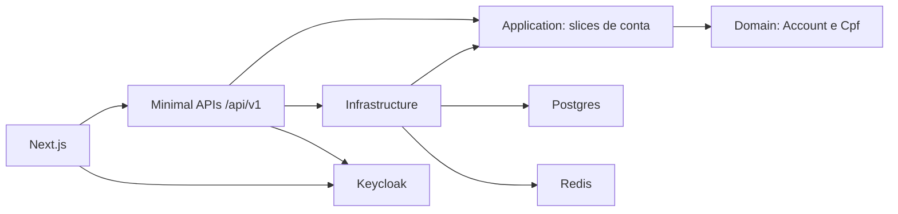

# Arquitetura

O backend tem um único host ASP.NET Core. O contexto de Onboarding organiza o domínio e os casos de uso de conta. Fraude e Cartões são contextos externos simulados e consomem contratos separados. A separação dos projetos impede dependências da camada de domínio em infraestrutura.



- **Domain** contém o agregado `Account`, os valores `Cpf`, `AccountHolderName`, `AccountSubject`, `AccountId` e `AccountVersion`, os eventos e `Result`. A conta decide se uma abertura, edição, exclusão, transferência de carteira ou vínculo de titular pode ocorrer e se a operação mudou seu estado.
- **Application** executa abertura, alteração e exclusão e depende de portas de persistência. As operações HTTP permanecem em Api.
- **Infrastructure** implementa portas com EF Core, PostgreSQL, Redis e outbox. A mesma transação confirma a conta, o recibo idempotente e o evento.
- **Api** autentica, autoriza e adapta os resultados ao contrato HTTP. Serilog registra requisições e falhas de infraestrutura.
- **Web** autentica por OIDC com PKCE, guarda o access token em cookie HttpOnly e encaminha requisições por uma rota de servidor.
- **Infra** usa Compose para PostgreSQL, Redis, Keycloak e Nginx.

Os modelos de persistência e os contratos HTTP representam dados nas fronteiras. A infraestrutura reconstitui o agregado para alterações, aplica o estado resultante e grava a auditoria. As consultas podem projetar seus modelos de leitura diretamente. O PostgreSQL mantém as restrições que dependem de mais de uma conta, como a unicidade de CPF e de titular vinculado.

A chave idempotente é escopada ao cliente e ao sujeito do token. O PostgreSQL serializa tentativas para o mesmo escopo e chave com um lock transacional. O recibo expira em 24 horas. Redis guarda consultas individuais até a próxima meia-noite em São Paulo e usa uma geração por conta para evitar que uma leitura concorrente recoloque uma versão antiga após a invalidação. A outbox repete a invalidação após falhas e distribui os eventos para caixas de entrada locais.

O enunciado pede CRUD, os dados de conta, notificações e redução de leituras repetidas. Esses comportamentos têm testes de domínio, arquitetura, integração e navegador. Usamos Minimal APIs em .NET 10 para definir rotas HTTP diretamente e manter os casos de uso separados do transporte. A Microsoft recomenda começar com Minimal APIs em novos projetos de API HTTP pela configuração reduzida. [Orientação da Microsoft sobre APIs HTTP no ASP.NET Core](https://learn.microsoft.com/aspnet/core/fundamentals/apis?view=aspnetcore-10.0).

As versões diretas ficam em `Directory.Packages.props`. Cada `packages.lock.json` registra o grafo resolvido e é verificado com `dotnet restore --locked-mode`. [Gerenciamento central de pacotes NuGet](https://learn.microsoft.com/nuget/consume-packages/central-package-management).

## Organização dos arquivos

| Projeto | Onde encontrar o código |
|---|---|
| `Contas.Api` | `Startup` compõe o host, `Security` define autorização e `Http` agrupa rotas e contratos de Onboarding, Fraude e Cartões. Os contratos e as respostas comuns ficam em pastas próprias dentro de `Http`. |
| `Contas.Application` | `Accounts` agrupa comandos, consultas, contratos e portas de contas. |
| `Contas.Domain` | `Accounts` contém o agregado, CPF, status e evento. `Primitives` contém `Result` e os tipos de erro. |
| `Contas.Infrastructure` | `Persistence` separa contas, auditoria, registros de mensageria e migrações. O cache Redis e o worker de entrega ficam em `Cache` e `Notifications`. |
| `Contas.Web` | `app` define as rotas do Next.js, `features/accounts` reúne a interface e a lógica de contas, `components` separa autenticação de componentes reutilizáveis e `lib/server` reúne OIDC e opções de servidor. |

## Comandos e consultas

Os casos de uso de conta ficam em `src/Contas.Application/Accounts`, com uma pasta por operação. Em `Commands`, cada comando descreve uma alteração e seu handler executa as regras e chama a porta de escrita. Em `Queries`, cada consulta define os dados pedidos e seu handler usa a porta de leitura. As duas categorias compartilham o PostgreSQL e retornam `Result`.

Os endpoints autorizam a chamada e enviam a mensagem pelo `ISender`. A camada Application referencia `Mediator.Abstractions` e a API usa `Mediator.SourceGenerator` para registrar os handlers na compilação. O mediator e os handlers usam o escopo da requisição para acessar o mesmo `DbContext`. O seed também envia o comando de abertura dentro de um escopo próprio. [Documentação do Mediator](https://github.com/martinothamar/Mediator)

A gravação transacional e o processamento da outbox continuam na infraestrutura. A criação, a edição e a exclusão gravam a conta, o recibo idempotente, a auditoria e o evento da outbox na mesma transação. Após o commit, o worker entrega os eventos a Fraude e Cartões.

## Auditoria de contas

O PostgreSQL registra as alterações em `audit.account_changes`. Cada linha contém o ID da conta, a ação, o instante em UTC e o autor no formato `azp:sub`, com o cliente e o identificador estável do usuário obtidos do token validado do Keycloak. A criação pelo seed usa `system:seed`.

A trilha cobre abertura, edição de nome ou status, exclusão lógica, atribuição de carteira e vínculo do titular. A gravação ocorre na mesma transação da alteração. Operações rejeitadas, reenvios idempotentes e alterações sem efeito não criam registros. A trilha fica separada da outbox e não guarda CPF, nome ou token. A migração só registra operações feitas após sua aplicação, pois as alterações antigas não têm autoria verificável.

Para consultar o histórico de uma conta no PostgreSQL, use o UUID da conta:

```sql
SELECT "Action", "Actor", "OccurredAt"
FROM audit.account_changes
WHERE "AccountId" = '<uuid-da-conta>'
ORDER BY "Id";
```

O Operador pode abrir **Histórico de alterações** na área de contas e consultar todos os registros ou filtrar pelo UUID de uma conta. A tela usa `GET /api/v1/accounts/history`, que exige a role de Operador, aceita `accountId`, `limit` e `before`, e retorna os registros mais recentes primeiro. Use `nextBefore` para pedir a próxima página. A consulta inclui contas excluídas e mostra o autor pelo identificador gravado, sem consultar o diretório do Keycloak.
