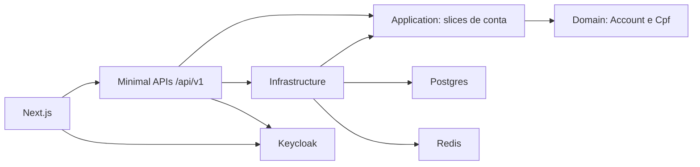

# Arquitetura

O backend tem um único host ASP.NET Core. O contexto de Onboarding organiza o domínio e os casos de uso de conta. Fraude e Cartões são contextos externos simulados e consomem contratos separados. A separação dos projetos impede dependências da camada de domínio em infraestrutura.

- **Domain** contém o agregado, o valor CPF, eventos e Result. As regras esperadas usam resultados com códigos estáveis.
- **Application** executa abertura, alteração e exclusão e depende de portas de persistência. As operações HTTP permanecem em Api.
- **Infrastructure** implementa portas com EF Core, PostgreSQL, Redis e outbox. A mesma transação confirma a conta, o recibo idempotente e o evento.
- **Api** autentica, autoriza e adapta os resultados ao contrato HTTP. Serilog registra requisições e falhas de infraestrutura.
- **Web** autentica por OIDC com PKCE, guarda o access token em cookie HttpOnly e encaminha requisições por uma rota de servidor.
- **Infra** usa Compose para PostgreSQL, Redis, Keycloak e Nginx.

A chave idempotente é escopada ao cliente e ao sujeito do token. O PostgreSQL serializa tentativas para o mesmo escopo e chave com um lock transacional. O recibo expira em 24 horas. Redis guarda consultas individuais até a próxima meia-noite em São Paulo e usa uma geração por conta para evitar que uma leitura concorrente recoloque uma versão antiga após a invalidação. A outbox repete a invalidação após falhas e distribui os eventos para caixas de entrada locais.

O enunciado pede CRUD, os dados de conta, notificações e redução de leituras repetidas. Esses comportamentos têm testes de domínio, arquitetura, integração e navegador. Usamos Minimal APIs em .NET 10 para definir rotas HTTP diretamente e manter os casos de uso separados do transporte. A Microsoft recomenda começar com Minimal APIs em novos projetos de API HTTP pela configuração reduzida. [Orientação da Microsoft sobre APIs HTTP no ASP.NET Core](https://learn.microsoft.com/aspnet/core/fundamentals/apis?view=aspnetcore-10.0).

As versões diretas ficam em `Directory.Packages.props`. Cada `packages.lock.json` registra o grafo resolvido e é verificado com `dotnet restore --locked-mode`. [Gerenciamento central de pacotes NuGet](https://learn.microsoft.com/nuget/consume-packages/central-package-management).
