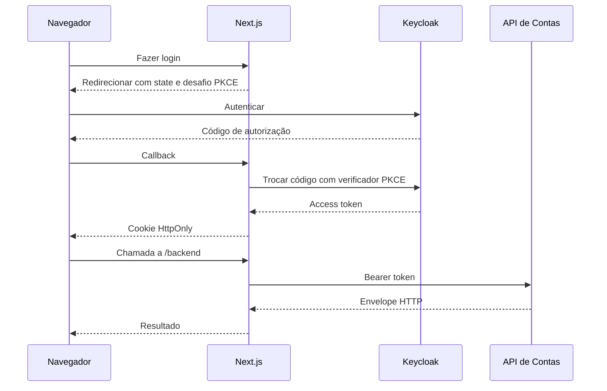

# Login, perfis e integrações

[Início](../README.md) · [Funcionalidades](spec.md) · [Execução](execucao.md)

Keycloak autentica pessoas e APIs externas. A API de Contas combina cliente, role e vínculo da conta para decidir o acesso.

## Usuários locais

| Usuário | Senha local | Role | Acesso |
|---|---|---|---|
| `operador` | `operador-local` | `accounts-operator` | Administração de todas as contas e histórico |
| `gerente-a` | `gerente-a-local` | `accounts-manager` | Contas da sua carteira |
| `gerente-b` | `gerente-b-local` | `accounts-manager` | Contas da sua carteira |
| `cliente` | `cliente-local` | `accounts-customer` | Consulta da própria conta vinculada |
| `admin` | `admin-local` | Administrador do Keycloak | Console de identidade, separado das permissões da aplicação |

Esses valores são exclusivos da demonstração local. O realm é `contas`. Em um ambiente novo, o Compose importa usuários e clientes automaticamente. Em um realm existente, o import preserva a configuração anterior.

## Permissões por ação

| Ação | Operador | Gerente | Cliente |
|---|---|---|---|
| Listar e consultar | Todas as contas | Própria carteira | Própria conta |
| Abrir | Sim | Sim, já atribuída à própria carteira | Acesso negado |
| Editar, ativar, inativar e excluir | Todas as contas | Própria carteira | Acesso negado |
| Transferir carteira | Sim | Acesso negado | Acesso negado |
| Vincular titular | Sim | Acesso negado | Acesso negado |
| Consultar auditoria | Sim | Acesso negado | Acesso negado |

O servidor filtra as consultas por carteira ou titular. Acesso por UUID fora do escopo retorna 404. O replay de escrita também verifica o acesso vigente, incluindo transferências feitas depois da primeira tentativa.

## Preparar carteiras para testar

1. Entre como `gerente-a` e abra uma conta fictícia. Ela será atribuída à carteira A.
2. Entre como `gerente-b` e abra outra conta. Ela será atribuída à carteira B.
3. Entre como Operador e use **Vincular titular** em uma das contas com o UUID do cliente.
4. Entre como Cliente e confira a conta vinculada.
5. Como Operador, use **Transferir carteira** e confira a mudança de acesso dos gerentes.

| Identidade | UUID no realm versionado |
|---|---|
| Gerente A | `74113d8a-7870-4e36-a8f8-141a69a8a601` |
| Gerente B | `74113d8a-7870-4e36-a8f8-141a69a8a602` |
| Cliente | `74113d8a-7870-4e36-a8f8-141a69a8a603` |

Em realms criados anteriormente, confira os IDs no console Keycloak. A API valida o formato UUID e persiste o vínculo. Cabe ao Operador selecionar uma identidade existente com a role adequada, pois o vínculo não consulta o diretório do Keycloak.

As rotas `PUT /api/v1/accounts/{id}/portfolio` e `PUT /api/v1/accounts/{id}/owner` recebem `{"subject":"<UUID>"}` e exigem Operador. [Contrato completo](openapi.json)

## Login da interface



O cliente público `contas-web` usa Authorization Code com PKCE. O callback confere `state`. O token fica no cookie `contas_access`, HttpOnly e SameSite=Lax, com Secure quando a origem usa HTTPS. O proxy `/backend` confere a origem nas escritas e encaminha o token no servidor. Ao expirar a sessão, o usuário inicia um novo login.

A API valida assinatura, emissor, validade e audiência `contas-api`. As políticas conferem também `azp`, o cliente autorizado, e as roles. O Operador administra Contas pelo cliente web. As rotas de integração exigem o cliente de serviço correspondente.

## Clientes externos

| Cliente Keycloak | Secret local | Role | Rota permitida |
|---|---|---|---|
| `fraud-api` | `fraud-api-local` | `fraud-reader` | `/api/v1/fraud/accounts/{id}/status` |
| `cards-api` | `cards-api-local` | `cards-reader` | `/api/v1/cards/accounts/{id}/eligibility` |

Obtenha um token de Fraude com Bash, curl e jq. Substitua `ID` pelo UUID de uma conta criada na aplicação.

```bash
BASE=http://localhost:8080
ID='<UUID-da-conta>'
FRAUD_TOKEN=$(curl -fsS "$BASE/auth/realms/contas/protocol/openid-connect/token" \
  --data grant_type=client_credentials --data client_id=fraud-api \
  --data client_secret=fraud-api-local | jq -r .access_token)

curl -i -H "Authorization: Bearer $FRAUD_TOKEN" "$BASE/api/v1/fraud/accounts/$ID/status"
curl -i -H "Authorization: Bearer $FRAUD_TOKEN" "$BASE/api/v1/cards/accounts/$ID/eligibility"
```

Para uma conta existente, a primeira chamada retorna 200 e a segunda 403. Repita a obtenção do token com `client_id=cards-api` e `client_secret=cards-api-local` para testar Cartões.

No modo `demos`, as APIs em 5091 e 5092 obtêm seus tokens no servidor e encaminham as consultas.

```bash
curl "http://localhost:5091/api/v1/accounts/$ID"
curl "http://localhost:5092/api/v1/accounts/$ID"
```

Para iniciar somente o cliente de demonstração de Fraude no host, com a stack de Contas já disponível.

```bash
Partner__ClientId=fraud-api \
Partner__Secret=fraud-api-local \
Partner__TokenEndpoint=http://localhost:8080/auth/realms/contas/protocol/openid-connect/token \
Partner__AccountsApi=http://localhost:8080 \
Partner__ResourcePath='/api/v1/fraud/accounts/{id}/status' \
dotnet run --project samples/Contas.PartnerDemo --urls http://127.0.0.1:5090
```

Consulte `http://localhost:5090/api/v1/accounts/$ID`. A entrega assíncrona por filas é descrita em [mensageria](mensageria.md).
