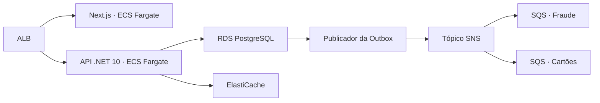

# Proposta de produção na AWS

1. Empacotar API e Next.js em imagens no ECR. Executar os serviços em ECS Fargate atrás de um Application Load Balancer com TLS. Encaminhar /api para a API e as demais rotas para o Next. Manter banco e cache em sub-redes privadas.
2. Usar o adaptador EF Core e PostgreSQL já implementado com uma instância RDS. Manter conta, Outbox e recibo idempotente na mesma transação. Reservar a chave com restrição única por identidade autenticada e chave, comparar a impressão da operação e persistir a resposta antes do commit. Limpar recibos expirados em lotes.
3. Usar um publicador que reserve lotes concorrentes no PostgreSQL e publique no SNS. Criar uma fila SQS e uma fila de mensagens não processadas para cada consumidor. Deduplicar pelo ID do evento e usar a versão da conta para lidar com entregas fora de ordem. Para fluxos que dependem de todas as transições em sequência, configurar SNS/SQS FIFO com grupo por ID de conta.
4. Usar o adaptador Redis já implementado com ElastiCache. Invalidar após o commit e repetir invalidações por evento. Usar versão monotônica ou marcador de versão no cache para impedir que leituras concorrentes repovoem uma versão antiga. Definir a tolerância a atraso e consultar a origem para operações que exigem leitura atual.
5. Integrar identidade e autorização por operação, armazenar segredos no Secrets Manager, restringir permissões com IAM e limitar o Scalar ao ambiente apropriado. Acompanhar latência, acertos de cache, atraso de publicação e mensagens nas filas de falhas no CloudWatch.

O perfil local já usa PostgreSQL, Redis e Keycloak. Na AWS, configure a identidade de produção, substitua a entrega local por SNS e SQS e aplique as migrações como uma etapa de release.
