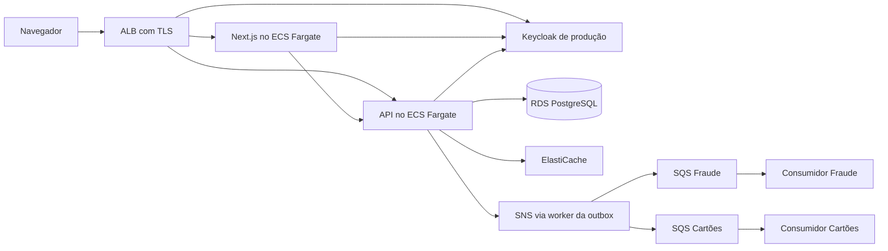
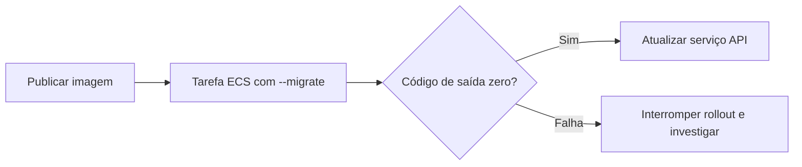

# Proposta de implantação na AWS

[Início](../README.md) · [Arquitetura](arquitetura.md) · [Mensageria](mensageria.md)

O repositório executa a stack local com Docker Compose. Esta página descreve a implantação proposta na AWS e as adaptações necessárias para operá-la em produção.

## Topologia proposta

| Serviço | Motivo da escolha | Preparação |
|---|---|---|
| ECR | Armazenar as imagens da API, web e consumidores | Fixar digest por release |
| ECS Fargate | Executar contêineres sem administrar hosts | Definir CPU, memória, rede, escala e verificações de saúde |
| ALB + certificado TLS | Entrada HTTPS e roteamento por caminho | Encaminhar `/api`, `/auth` e frontend aos serviços corretos |
| RDS PostgreSQL | Preservar transações e restrições já usadas | Configurar backups, acesso privado e credenciais por função |
| ElastiCache | Cache compartilhado entre réplicas | Validar conexão, TLS e tolerância a dados temporariamente antigos |
| SNS + SQS + DLQs | Fan-out com consumo independente e recuperação de falhas | Criar políticas, assinaturas e monitoramento das filas |
| Keycloak de produção | Manter OIDC e roles existentes | Configurar hostname, proxy, TLS, disponibilidade e banco persistente |
| Secrets Manager + IAM | Segredos externos às imagens e identidade das tarefas | Conceder permissões por serviço |
| CloudWatch | Centralizar logs e métricas operacionais | Configurar coleta, painéis e alarmes |

## Adaptar a configuração

- Configure `Messaging__TopicArn` e `Messaging__Region` para o SNS real. Deixe `Messaging__Endpoint` ausente para usar o endpoint regional e as credenciais da tarefa.
- Em cada consumidor, configure a fila própria e uma assinatura com entrega bruta. Use `sns:Publish` no tópico para a API e permissões SQS restritas à fila do consumidor.
- Substitua as credenciais locais de PostgreSQL, clientes Keycloak e administração por segredos do ambiente.
- Configure `APP_ORIGIN`, emissores OIDC, audiência e destinos internos com os endereços de produção. Habilite HTTPS na validação de identidade.
- Restrinja o acesso ao Scalar e ao painel de mensagens conforme os operadores autorizados. Os endpoints de histórico das demos precisam de autenticação para exposição pública.

## Migrações no release

Use o mesmo digest na tarefa de migração e no serviço. A imagem executa `dotnet Contas.Api.dll --migrate` e encerra após aplicar o schema. Injete `ConnectionStrings__Accounts` e mantenha `Seed__Enabled=false`.

A credencial de migração precisa de permissão de DDL. A credencial da API deve acessar os objetos e operações necessários ao runtime. Mudanças de schema devem ser compatíveis com a versão anterior durante o rollout. Quando houver revisão de SQL, gere um script idempotente do EF Core para esse processo. [Aplicação de migrações](https://learn.microsoft.com/ef/core/managing-schemas/migrations/applying)

## Pontos a concluir para produção

| Área | Situação atual | Evolução necessária |
|---|---|---|
| Publicador | Lock transacional mantido durante publicação do lote | Para maior volume, reservar eventos com expiração e publicar fora da transação longa |
| Consumidores | SQLite por instância demonstrativa | Armazenamento durável compartilhado por réplicas, com deduplicação |
| Ordem de eventos | Filas padrão e histórico por evento | Aplicar controle de versão ou FIFO por conta quando o negócio exigir sequência |
| Cache | Invalidação após commit e retry pela outbox | Definir tolerância a atraso e leituras que exigem dados atuais |
| Saúde | `/health` responde pelo processo HTTP | Definir readiness e observabilidade das dependências |
| Observabilidade | Logs Serilog na saída do processo | Alarmes para erros, atraso da outbox, backlog e DLQs |
| Infraestrutura | Compose local e desenho AWS | Implementar recursos, políticas e pipeline de implantação |

O processamento continua sujeito a reentregas. A deduplicação deve acompanhar qualquer efeito de negócio adicionado aos consumidores. [Garantias do fluxo atual](mensageria.md)
