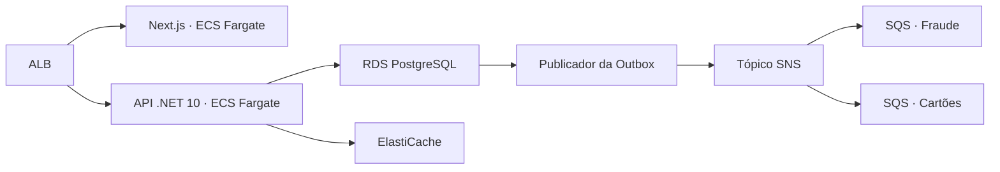

# Proposta de produção na AWS

1. Empacotar API e Next.js em imagens no ECR. Executar os serviços em ECS Fargate atrás de um Application Load Balancer com TLS. Encaminhar /api para a API e as demais rotas para o Next. Manter banco e cache em sub-redes privadas.
2. Usar o adaptador EF Core e PostgreSQL já implementado com uma instância RDS. Manter conta, Outbox e recibo idempotente na mesma transação. Reservar a chave com restrição única por identidade autenticada e chave, comparar a impressão da operação e persistir a resposta antes do commit. Limpar recibos expirados em lotes.
3. Usar um publicador que reserve lotes concorrentes no PostgreSQL e publique no SNS. Criar uma fila SQS e uma fila de mensagens não processadas para cada consumidor. Deduplicar pelo ID do evento e usar a versão da conta para lidar com entregas fora de ordem. Para fluxos que dependem de todas as transições em sequência, configurar SNS/SQS FIFO com grupo por ID de conta.
4. Usar o adaptador Redis já implementado com ElastiCache. Invalidar após o commit e repetir invalidações por evento. Usar versão monotônica ou marcador de versão no cache para impedir que leituras concorrentes repovoem uma versão antiga. Definir a tolerância a atraso e consultar a origem para operações que exigem leitura atual.
5. Integrar identidade e autorização por operação, armazenar segredos no Secrets Manager, restringir permissões com IAM e limitar o Scalar ao ambiente apropriado. Acompanhar latência, acertos de cache, atraso de publicação e mensagens nas filas de falhas no CloudWatch.

O perfil local já usa PostgreSQL, Redis e Keycloak. Na AWS, configure a identidade de produção e substitua a entrega local por SNS e SQS.

## Migrações no release

A API inicia o servidor HTTP sem aplicar migrações ou executar seed. Use uma tarefa ECS avulsa para migrar o PostgreSQL antes de atualizar o serviço da API:

1. Publique a imagem da API no ECR e fixe o mesmo digest na tarefa de migração e no serviço. Configure o comando da tarefa avulsa como `["--migrate"]`. O entrypoint da imagem executa `dotnet Contas.Api.dll --migrate` e encerra sem servir HTTP.
2. Injete `ConnectionStrings__Accounts` a partir do Secrets Manager. A credencial da tarefa de migração deve poder modificar o schema. A credencial do serviço da API deve acessar somente os objetos e operações que usa, sem permissões de DDL. Configure as permissões dos novos objetos para essa credencial. Mantenha `Seed__Enabled` desabilitado em produção.
3. Faça o pipeline aguardar o término da tarefa e verificar o código de saída do contêiner. Atualize o serviço somente após uma saída com código zero. Em caso de falha, interrompa o rollout e examine o erro antes de tentar novamente.
4. Mantenha cada mudança de schema compatível com a versão anterior da API durante a atualização gradual. Adicione as estruturas novas primeiro, migre os consumidores e retire estruturas antigas em um release posterior.

Quando o processo de release exigir revisão de SQL, gere e revise o script idempotente do EF Core e aplique-o como alternativa à tarefa de migração. [Documentação do EF Core sobre aplicação de migrações](https://learn.microsoft.com/pt-br/ef/core/managing-schemas/migrations/applying)
