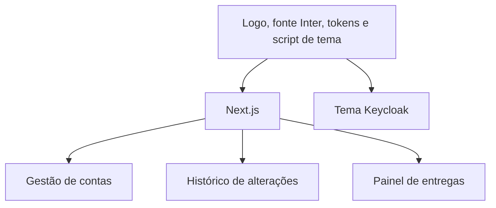

# Design e experiência de uso

[Início](../README.md) · [Funcionalidades](spec.md) · [Testes](testes.md)

A interface segue a biblioteca `design_system_component_library_v2_banco_krt` do ZIP `stitch_banco_krt_account_redesign.zip`. Os componentes v2 orientam a identidade visual, e as telas do export orientam a composição dos fluxos.

## Componentes compartilhados

Os recursos ficam em `src/Contas.Web/public/brand`, incluindo a licença da fonte. O Compose monta os mesmos arquivos no tema Keycloak. `Brand`, `Icon` e `ThemeSwitcher` são componentes React reutilizáveis. Cores e espaçamentos ficam nos estilos compartilhados.

O painel de entregas usa o mesmo frontend Next.js, servido pelo gateway da porta 5093. A página de auditoria fica na aplicação principal e exige Operador. [Fluxo de entregas](mensageria.md)

## Telas e estados

| Tela | Conteúdo | Adaptação mobile |
|---|---|---|
| Entrada | Marca, ação **Fazer login** e avisos de autenticação | Composição vertical |
| Login Keycloak | Usuário, senha, mostrar senha e erros | Campos e ações ajustados à tela |
| Saída Keycloak | Confirmação e retorno à aplicação | Card central e ações acessíveis |
| Gestão de contas | Lista, busca na página, status, paginação e ações por permissão | Tabela vira cartões |
| Abertura e edição | Nome, CPF e status conforme operação | Drawer vira bottom sheet |
| Carteira e titular | Conta selecionada e UUID da identidade | Mesmo padrão de formulário |
| Exclusão | Resumo da conta e confirmação | Botões empilhados |
| Histórico de alterações | Ação, conta, autor, horário, filtro e paginação | Registros em coluna |
| Histórico de entregas | Consumidor, processamento, JSON e paginação | Cards em coluna e JSON com quebra de linha |
| Estados de retorno | Carregando, lista vazia, filtro vazio, erro, sessão expirada e acesso negado | Feedback próximo da ação |

A lista de contas vira cartões abaixo de 960 px, com duas colunas no tablet e uma abaixo de 640 px. Os formulários viram bottom sheet até 640 px. Diálogos mantêm rolagem interna, foco inicial, Escape e retorno ao acionador.

## Paleta e geometria

Os valores da seção **Tokens Visuais & Fundamentos** da v2 orientam a paleta clara. As variações do tema escuro usam tokens por função, preservando tipografia e geometria.

| Uso | Claro | Escuro |
|---|---|---|
| Ação primária | `#0A2540` | `#8DB9E8` |
| Texto principal | `#0F172A` | `#E8EEF7` |
| Texto secundário | `#334155` | `#C1CCDC` |
| Fundo | `#FAF8FF` | `#080F1C` |
| Sucesso | `#059669` sobre `#ECFDF5` | `#6EE7B7` sobre `#0D342D` |
| Exclusão/erro | `#DC2626` sobre `#FEF2F2` | `#FECACA` sobre `#3A1B28` |

Campos, botões e cartões usam raios de 8, 12 e 16 px. A fonte é Inter, servida localmente. A marca ganha aparência clara monocromática por CSS no tema escuro. [Tokens implementados](../src/Contas.Web/public/brand/tokens.css)

## Preferência de aparência

| Escolha | Comportamento |
|---|---|
| Sistema | Padrão. Acompanha a preferência do dispositivo e suas mudanças |
| Claro ou Escuro | Prevalece sobre o sistema e persiste em `localStorage` |
| Armazenamento bloqueado | Troca continua funcionando na página atual |

O script `theme.js` aplica `data-theme` antes do React carregar. A chave `krt-appearance` sincroniza a preferência entre abas da mesma origem. Aplicação e Keycloak compartilham a escolha pelo Nginx. O painel em 5093 tem preferência própria por estar em outra origem.

## Manutenção do Keycloak

O tema `banco-krt` herda formulários de `keycloak.v2`. Seu `template.ftl` deriva do Keycloak 26.6.2. Ao atualizar essa dependência, compare o template com a nova versão para preservar ações, mensagens e scripts nativos.

O `darkMode=false` em `theme.properties` deixa o controle da aparência com o script compartilhado. Em realms existentes, confira **Realm settings → Themes → Login theme → banco-krt** e o idioma `pt-BR`.

## Referências do export

| Fluxo | Referência original |
|---|---|
| Entrada | `entrada_do_operador_pr_login` e variante mobile |
| Login e saída | `tema_keycloak_login_confirma_o_de_sa_da` e `autentica_o_keycloak_logout_mobile` |
| Contas desktop | `rea_de_trabalho_gest_o_de_contas_slide_over_sheet_moderno` |
| Contas mobile | `gest_o_de_contas_mobile` e `AccountCard` |
| Abertura e edição | `SlideOver` e `abrir_e_editar_conta_bottom_sheet_mobile` |
| Exclusão | `ConfirmModal` e `confirma_o_de_exclus_o_mobile` |
| Carteira, titular e históricos | Componentes e tokens compartilhados da biblioteca v2 |

Playwright verifica os temas, larguras, foco e estados. As capturas anexadas permitem comparar o resultado visual. [Cenários e comandos](testes.md)
