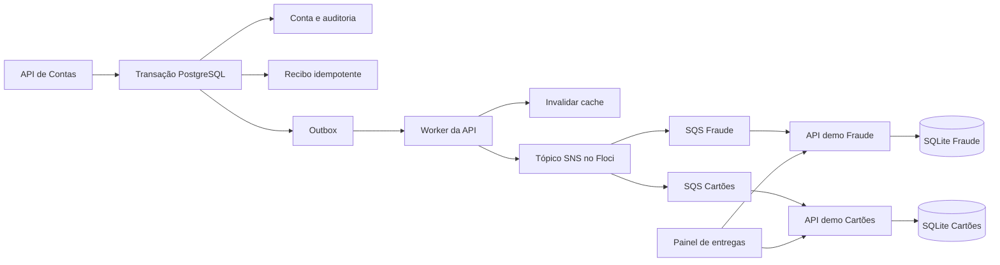

# Eventos e histórico de entregas

[Início](../README.md) · [Execução](execucao.md) · [Arquitetura](arquitetura.md)

Ao abrir, editar ou excluir uma conta, a aplicação registra um evento junto com a alteração. O worker entrega esse evento a Fraude e Cartões. Cada consumidor mantém seu próprio histórico.

## Fluxo no modo demos

SNS distribui uma cópia para cada fila. Cada API consulta a própria fila SQS e processa no seu ritmo. Essa topologia permite que cada consumidor receba o mesmo evento independentemente. [Fan-out SNS/SQS](https://docs.aws.amazon.com/sns/latest/dg/sns-sqs-as-subscriber.html)

| Elemento | Nome ou comportamento |
|---|---|
| Tópico | `account-events` |
| Filas | `fraud-events` e `cards-events` |
| Filas de falhas | `fraud-events-dlq` e `cards-events-dlq`, com política de redrive de 5 recebimentos |
| Entrega SNS → SQS | JSON direto do evento, com `RawMessageDelivery` |
| Eventos | `AccountCreated`, `AccountUpdated`, `AccountDeleted` |
| Corpo | `EventId`, `AccountId`, `Type`, `Version`, `Status` e `OccurredAt` |
| Histórico | SQLite em `/data/messages.db`, em um volume por consumidor |

No evento, `Status` é numérico, com `0` para ativa e `1` para inativa. `OccurredAt` registra o instante da alteração. Nome e CPF ficam fora do payload.

## Entrega e falhas

| Situação | Comportamento implementado |
|---|---|
| API confirma a alteração | Conta e evento já estão persistidos na mesma transação |
| SNS indisponível | Evento continua pendente na outbox para outra tentativa |
| Redis falha na invalidação | Publicação dessa conta aguarda nova tentativa de invalidação |
| Evento chega novamente | `event_id` único no SQLite preserva um registro por consumidor |
| Processamento é repetido | Resultado só é gravado se `processed_at` ainda estiver vazio |
| Consumidor termina | Mensagem é removida da SQS após persistir o processamento |
| JSON inválido ou falha no SQLite | Mensagem permanece na fila e segue a política de redrive |

A entrega é **pelo menos uma vez**. Uma falha após publicar no SNS e antes de confirmar a outbox pode repetir o envio. As demos deduplicam por evento. As filas padrão permitem entregas fora de ordem, e a demonstração registra cada evento sem reconstruir um estado agregado por versão.

O worker atual verifica pendências a cada segundo, lê até 100 eventos e mantém um lock transacional durante o lote. Isso serializa os publicadores. A [proposta AWS](aws.md) descreve a evolução para maior volume.

## Ver funcionando

1. Rode `bash scripts/run.sh demos` ou `./scripts/run.ps1 -Mode demos`.
2. Abra a aplicação, entre como Operador e crie uma conta com dados fictícios.
3. Abra o [painel de entregas](http://localhost:5093/).
4. Alterne entre **Fraude** e **Cartões** e compare o ID do evento.
5. Expanda **Ver mensagem** para conferir o JSON e o resultado simulado.

O painel consulta a API a cada 15 segundos e também permite atualização manual. Filtro, página selecionada e detalhes abertos são preservados durante a atualização. Mensagens antigas sem payload exibem os campos registrados. O painel reutiliza os componentes e temas do Next.js e é publicado por um gateway próprio na porta 5093.

| Endpoint local | Resposta |
|---|---|
| `http://localhost:5091/api/v1/messages` | Histórico de Fraude |
| `http://localhost:5092/api/v1/messages` | Histórico de Cartões |
| `http://localhost:5093/fraud/messages` | Proxy do histórico de Fraude |
| `http://localhost:5093/cards/messages` | Proxy do histórico de Cartões |

O contrato desse histórico é `{ consumer, items, nextBefore }`, com 25 itens por página. Envie `?before=<nextBefore>` para consultar mensagens anteriores. As rotas de histórico das demos são locais e abertas, publicadas em `127.0.0.1` pelo Compose.

## Modo padrão e processamento demonstrativo

Sem `Messaging__TopicArn`, o worker grava duas cópias em `Inbox` no PostgreSQL. Ao iniciar o modo `demos`, os eventos pendentes passam a ser publicados no SNS. Eventos já marcados como publicados na inbox seguem registrados ali.

Fraude registra a sinalização da conta para análise. Cartões registra elegibilidade baseada no status ativo. As exclusões encerram essas situações. Carteiras e vínculos de titular são registrados na auditoria de Contas.

O arquivo `infra/messaging/provision.py` cria a topologia usando boto3 dentro da imagem Floci. O teste automatizado publica, verifica os dois históricos e reenvia o mesmo evento para validar a deduplicação. [Testes](testes.md)
